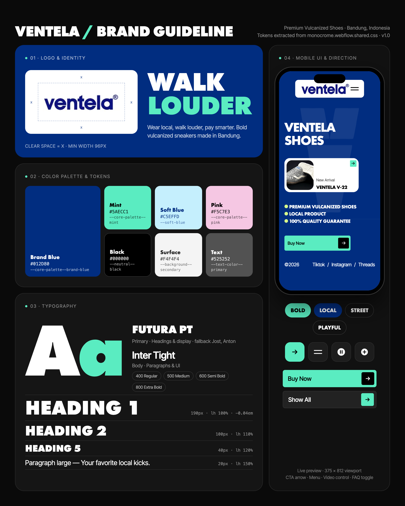

# 👟 Ventela — Website Redesign (Free Source Code)

Konsep **redesign website [Ventela](https://ventela.co.id)**, brand sepatu vulcanized lokal asal Bandung, dibuat sebagai landing page yang bold, playful, dan penuh animasi scroll.

Source code ini **gratis** — boleh dipelajari, dimodifikasi, dan dipakai sebagai referensi untuk project kamu sendiri. 🎉

> ⚠️ Ini adalah project redesign / konsep portofolio, **bukan website resmi Ventela** dan tidak berafiliasi dengan Ventela. Nama, logo, dan foto produk adalah milik pemiliknya masing-masing.



## ✨ Fitur

- **Hero intro animation** — judul di-split per karakter (SplitText) + kartu dekoratif yang muncul bertahap.
- **Smooth scroll** dengan Lenis, tersinkron ke GSAP ScrollTrigger.
- **Pinned promotion section** — teks naik dari bawah sambil background berubah putih → biru brand (scrub).
- **Smart navbar** — sembunyi saat scroll ke bawah, muncul saat scroll ke atas, plus indikator section aktif.
- Section lengkap: Hero, Category, Promotion, Materials, Collaboration, Collection, FAQ, Footer + form kontak.
- **Lighthouse (desktop):** Performance 98 · Accessibility 89 · Best Practices 81 · SEO 100.


## 🛠️ Tech Stack

| Tech | Kegunaan |
| --- | --- |
| **Next.js 14** (App Router) | Framework & static generation |
| **React 18** | Komponen section (`components/*.jsx`) |
| **GSAP 3 + ScrollTrigger + SplitText** | Animasi scroll & teks |
| **Lenis** | Smooth scrolling |
| **esbuild** | Render komponen ke HTML statis (`gen-static.mjs`) |
| **Webflow CSS & IX runtime** | Basis layout & interaksi dari template asli |
| **Futura PT · Inter Tight** | Font heading & body |

## 🚀 Cara Menjalankan

Butuh **Node.js 18+**.

```bash
# 1. clone repo
git clone https://github.com/fandyramadhan/ventela.git
cd ventela

# 2. install dependencies
npm install

# 3. jalankan mode development → http://localhost:3000
npm run dev

# 4. build & jalankan versi production
npm run build
npm run start
```

`npm run dev` otomatis menjalankan generator (`gen-static.mjs --watch`) sehingga perubahan di `components/*.jsx` langsung terlihat.

## 📁 Struktur Folder

```
app/
  layout.jsx           <head>, font, script runtime GSAP/Webflow
  page.jsx             menyuntikkan HTML hasil render komponen
  _content.js          AUTO-GENERATED (jangan diedit manual)
  SmoothScroll.jsx     instance Lenis (window.lenis)
  SmartNavbar.jsx      hide/show navbar + indikator section aktif
  PromotionScroll.jsx  animasi pinned section #promotion
components/            Navbar, Preloader, Hero, Category, Promotion,
                       Services, Work, Team, Faq, Footer
public/assets/         CSS, font, gambar, video, runtime GSAP/Webflow
socmed/                aset promosi (video scroll, brand board, dll.)
```

> 💡 **Kenapa HTML statis?** Runtime Webflow/GSAP memanipulasi DOM saat load (SplitText, inline style), yang bentrok dengan hydration React. Jadi komponen dirender ke HTML statis lewat `gen-static.mjs`, lalu disuntikkan via `dangerouslySetInnerHTML` agar animasi berjalan mulus tanpa error hydration.

## 🎨 Kustomisasi

- **Warna & font** — atur CSS variable di `public/assets/monocrome.webflow.shared.8c6d9d2df.css`: `--core-palette--brand-blue: #012d80`, `--core-palette--mint: #5aecc1`, `--core-palette--soft-blue: #c5effd`, `--core-palette--pink: #f5c7e3`, `--neutral--black: #000`; font heading `--_font-family---primary-font` (Futura PT) dan body `--_font-family---body-font` (Inter Tight).
- **Konten section** — edit teks, gambar, dan link langsung di `components/*.jsx` (misalnya `Hero.jsx`, `Work.jsx` untuk kolaborasi, `Faq.jsx`, `Footer.jsx`).
- **Animasi promotion** — sesuaikan di `app/PromotionScroll.jsx`: `end: '+=150%'` (panjang scroll saat pin), `duration` tiap tween, dan warna tujuan `backgroundColor: '#012d80'`.
- **Smooth scroll** — atur `duration: 2.5` dan `easing` di `app/SmoothScroll.jsx`.
- **Kartu hero** — atur `HERO_DONE_MS` (kapan kartu mulai muncul) dan `STAGGER_MS` (jeda antar kartu) di `app/layout.jsx`.
- **Aset foto, video & logo** — ganti file di `public/assets/ventela-assets/`.

## ☕ Traktir Kopi

Kalau project ini bermanfaat dan kamu mau mendukung, boleh banget traktir kopi Rp10.000 😄

👉 [lynk.id/fandy.codesign](https://lynk.id/fandy.codesign)

Terima kasih banyak atas dukungannya! 🙏

## 🌐 Ikuti / Connect

Yuk follow & ngobrol soal desain dan coding:

- 📸 **Instagram** — [@fandy.codesign](https://instagram.com/fandy.codesign)
- 🎵 **TikTok** — [@fandy.codesign](https://tiktok.com/@fandy.codesign)
- 🧵 **Threads** — [@fandy.codesign](https://www.threads.net/@fandy.codesign)
