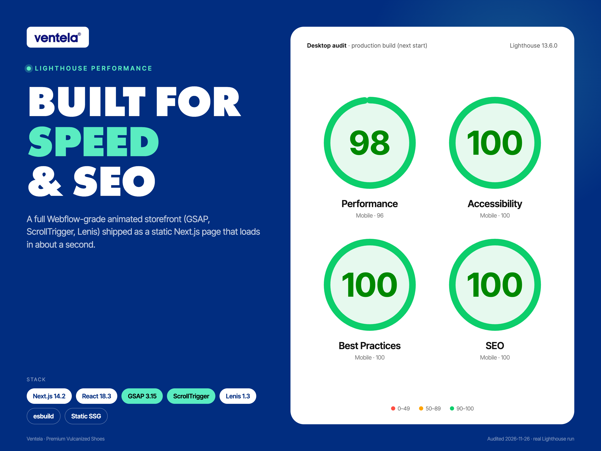

# 👟 Ventela — Website Redesign (Free Source Code)

A **website redesign concept for [Ventela](https://ventela.co.id)**, a local vulcanized sneaker brand from Bandung, Indonesia, built as a bold, playful landing page packed with scroll animations.

This source code is **free**: study it, modify it, and use it as a reference for your own projects. 🎉

> ⚠️ This is a redesign / portfolio concept, **not the official Ventela website**, and it is not affiliated with Ventela. All names, logos, and product photos belong to their respective owners.


## ✨ Features

- **Hero intro animation**: the title is split per character (SplitText), and decorative cards reveal one by one.
- **Smooth scrolling** with Lenis, synced to GSAP ScrollTrigger.
- **Pinned promotion section**: copy rises from below while the background scrubs from white to brand blue.
- **Smart navbar**: hides on scroll down, reappears on scroll up, with an active-section indicator.
- Full set of sections: Hero, Category, Promotion, Materials, Collaboration, Collection, FAQ, and Footer with a contact form.
- **Lighthouse (desktop):** Performance 98 · Accessibility 100 · Best Practices 100 · SEO 100. **(mobile):** 96 · 100 · 100 · 100.



## 🛠️ Tech Stack

| Tech | Purpose |
| --- | --- |
| **Next.js 14** (App Router) | Framework & static generation |
| **React 18** | Section components (`components/*.jsx`) |
| **GSAP 3 + ScrollTrigger + SplitText** | Scroll & text animations |
| **Lenis** | Smooth scrolling |
| **esbuild** | Renders components to static HTML (`gen-static.mjs`) |
| **Webflow CSS & IX runtime** | Layout and interaction base from the original template |
| **Futura PT · Inter Tight** | Heading & body fonts |

## 🚀 Getting Started

Requires **Node.js 18+**.

```bash
# 1. clone the repo
git clone https://github.com/fandyramadhan/ventela.git
cd ventela

# 2. install dependencies
npm install

# 3. start the dev server → http://localhost:3000
npm run dev

# 4. build & run the production version
npm run build
npm run start
```

`npm run dev` also runs the generator in watch mode (`gen-static.mjs --watch`), so edits to `components/*.jsx` show up immediately.

## 📁 Project Structure

```
app/
  layout.jsx           <head>, fonts, GSAP/Webflow runtime scripts
  page.jsx             injects the HTML rendered from the components
  _content.js          AUTO-GENERATED (do not edit by hand)
  SmoothScroll.jsx     Lenis instance (window.lenis)
  SmartNavbar.jsx      navbar hide/show + active-section indicator
  PromotionScroll.jsx  pinned #promotion section animation
components/            Navbar, Preloader, Hero, Category, Promotion,
                       Services, Work, Team, Faq, Footer
public/assets/         CSS, fonts, images, videos, GSAP/Webflow runtime
socmed/                promo assets (scroll video, brand board, etc.)
```

> 💡 **Why static HTML?** The Webflow/GSAP runtime rewrites the DOM on load (SplitText, inline styles), which conflicts with React hydration. So the components are rendered to static HTML by `gen-static.mjs` and injected via `dangerouslySetInnerHTML`, letting the animations run smoothly with no hydration errors.

## 🎨 Customization

- **Colors & fonts**: edit the CSS variables in `public/assets/ventela.webflow.css`: `--core-palette--brand-blue: #012d80`, `--core-palette--mint: #5aecc1`, `--core-palette--soft-blue: #c5effd`, `--core-palette--pink: #f5c7e3`, `--neutral--black: #000`; heading font `--_font-family---primary-font` (Futura PT) and body font `--_font-family---body-font` (Inter Tight).
- **Section content**: edit text, images, and links directly in `components/*.jsx` (e.g. `Hero.jsx`, `Work.jsx` for collaborations, `Faq.jsx`, `Footer.jsx`).
- **Promotion animation**: tweak `app/PromotionScroll.jsx`: `end: '+=150%'` (scroll length while pinned), each tween's `duration`, and the target color `backgroundColor: '#012d80'`.
- **Smooth scroll**: adjust `duration: 2.5` and `easing` in `app/SmoothScroll.jsx`.
- **Hero cards**: set `HERO_DONE_MS` (when the cards start appearing) and `STAGGER_MS` (delay between cards) in `app/layout.jsx`.
- **Photos, videos & logo**: replace the files in `public/assets/ventela-assets/`.

## ☕ Buy Me a Coffee

If this project helped you and you'd like to support it, a Rp10,000 coffee would be awesome 😄

👉 [lynk.id/fandy.codesign](https://lynk.id/fandy.codesign)

Thank you so much for your support! 🙏

## 🌐 Follow / Connect

Let's connect and chat about design and code:

- 📸 **Instagram** — [@fandy.codesign](https://instagram.com/fandy.codesign)
- 🎵 **TikTok** — [@fandy.codesign](https://tiktok.com/@fandy.codesign)
- 🧵 **Threads** — [@fandy.codesign](https://www.threads.net/@fandy.codesign)
